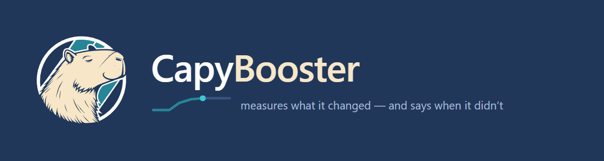

<p align="center">
  
</p>

<p align="center">
  <a href="https://github.com/kur7ma/CapyBooster/releases/latest"></a>
  <a href="https://github.com/kur7ma/CapyBooster/releases"></a>
  <a href="LICENSE"></a>
  
</p>

<p align="center">
  <b>English</b> ·
  <a href="README.ru.md">Русский</a> ·
  <a href="FAQ.md">FAQ</a> ·
  <a href="CHANGELOG.md">Changelog</a> ·
  <a href="SECURITY.md">Security</a>
</p>

<p align="center">
  <a href="https://github.com/kur7ma/CapyBooster/releases/latest/download/CapyBooster-latest.zip"></a>
</p>

CapyBooster tunes Windows for competitive games one step at a time. After each
group of changes it measures how fast the system responds and prints the
verdict, including "no difference we can measure". It is plain PowerShell, and
one click undoes everything it did.

## Download and run

1. Download [CapyBooster-latest.zip](https://github.com/kur7ma/CapyBooster/releases/latest/download/CapyBooster-latest.zip).
2. Optional, one minute: [check that the file is ours](#verify-your-download).
3. Unpack the **whole** archive into any folder. It will not run from inside the zip.
4. Run **START.cmd** and accept the administrator prompt.

The wizard asks for a language, checks the system, creates a restore point and
leads you through the steps in six groups: preparation, OS, CPU, GPU, game,
wrap-up. At each step you choose: Enter runs it, `s` skips it, `p` shows what it
would change, `a` finishes the rest unattended. A step that needs a reboot asks
first, even in unattended mode, and the wizard picks up where it stopped after
you sign in again.

## What you get

* **26 modules, 142 tweak cards.** A card says what the tweak touches, how sure
  we are (`measured`, `likely`, `disputed`), what effect to expect and what you
  pay for it. The wizard prints the cost before it asks.
* **A measurement after every group**, three runs per point. Among the verdicts
  you will see:
  * lateness went down, or went up;
  * indistinguishable: the change is smaller than the spread between the runs;
  * not comparable: between the two runs SMT was switched in the BIOS, or one
    of them ran on battery.

  On a machine so quiet that the instrument resolves nothing, the pack skips the
  synthetic measurements and tells you why.
* **Your games by name.** Profiles for Counter-Strike 2, Valorant, Apex Legends
  and Delta Force. The pack finds what you have installed and gives priority to
  the game's real executable.
* **NVIDIA and AMD Radeon** driver profiles, and a CPU/GPU power split on laptops.
* **Three experiments** measure whether a popular tweak helps on your machine:
  TimerTool, turning off multiplane overlay, turning off memory compression.
* **A check of its own work.** `verify.ps1` reads the live system, so it notices
  a setting that a driver update reset or that you changed by hand.
* **An HTML report** with the undo command next to every module.

## Popular tweaks get refused, with the reason

The report lists 22 popular tweaks the pack leaves alone, each with a reason.
Eight of them:

| Refused | Why |
|---|---|
| Turning off UAC | On Windows 11 it breaks Store apps, Settings, Terminal and Start menu search |
| A global 1 ms timer | Timer resolution has been per-process since Windows 10 2004 |
| ISLC and resident memory cleaners | The standby list is a file cache, not garbage |
| Deleting services | You get them back only by repairing Windows; the pack changes the startup type and nothing else |
| Killing Windows Update | Defender stops getting new definitions along with it |
| Nagle and TCP tweaks | Game traffic runs over UDP, where Nagle does not apply |
| Removing built-in apps | An app you never open does not use the CPU |
| Turning off performance counters | Afterburner, HWiNFO and Performance Monitor stop working |

## Verify your download

Check the archive before you run it:

1. **Checksum.** Every release carries a `SHA256SUMS` file, and GitHub shows the
   SHA-256 next to each file. In PowerShell, in the folder with the archive:

   ```powershell
   Get-FileHash .\CapyBooster-latest.zip -Algorithm SHA256
   ```

   The result must match the first line of `SHA256SUMS`, every character. In Git
   Bash or on Linux: `sha256sum -c --ignore-missing SHA256SUMS`.
2. **VirusTotal.** The notes of each release link the scan of that exact archive.
   For 5.6.5, none of the 65 engines found anything:
   [scan report](https://www.virustotal.com/gui/file/4560ed11b192e5c9a6de30d498cfe0b5b003cd64c06144c7a9d24bac3bc0c38f).

The 5.6.5 archive holds 189 files, all of them text: PowerShell scripts,
settings in JSON, NVIDIA profiles and documentation. You will find no .exe or
.dll in it. Two small helpers, a game launcher and a timing benchmark, come as
C# source in the same archive, and the pack builds them on your PC when a step
needs them.

The archive carries no digital signature, so Windows may say the publisher is
unknown. The checksum is how you confirm the file.

## What stays on your PC

* No service, driver or tray program. When the wizard finishes, nothing of it
  keeps running.
* Scheduled tasks carry the CapyBooster name: a one-time task that resumes the
  wizard after a reboot and, if you take the memory step, a task without a
  schedule that runs only when you start it before a game, with one command or
  your own shortcut. The interrupt module
  can add a task that reapplies its layout at sign-in, but only if you ask for
  it by hand.
* Network: the update check asks this repository for the latest version;
  `START.cmd -NoUpdateCheck` keeps the wizard offline. The tools step asks before
  it downloads PresentMon (Intel), GoInterruptPolicy and, on NVIDIA cards, NVIDIA
  Profile Inspector from their official GitHub releases. Each one is pinned to a
  version and checked against a stored SHA-256.
* No telemetry. The diagnostics archive stays on your PC until you send it, and
  it masks your account name, PC name, Steam account numbers and organization
  domain.

## Undo

* A system restore point before the run.
* Every module saves the old values before it writes, in the pack folder and in
  a machine-wide store, so deleting the folder keeps your way back.
* `UNDO.cmd` returns the system to where it was before the pack ever ran.
  `START.cmd undo -Preview` prints the plan and changes nothing.

## Requirements

* Windows 11 24H2 (build 26100) or newer is what the pack is tuned on.
* Windows 10 works. The wizard warns you at the start and skips the settings that
  exist only in Windows 11. Versions 5.6.1 and 5.6.4 fixed problems found on
  Windows 10.
* Administrator rights.
* Windows PowerShell 5.1, which ships with Windows. Nothing to install.

## Anti-cheat

The pack never touches Secure Boot or TPM, which FACEIT AC and Easy Anti-Cheat
need. Valorant is the exception: Vanguard needs memory integrity, so if Valorant
is installed, the wizard warns you before the step that turns it off. Skip that
step if you play Valorant.

## Updating and language

The wizard checks for a new version at start, shows what changed and updates the
folder in place. Your measurements, backups and progress stay.

English and Russian. The wizard picks the language of your Windows and remembers
your choice; `START.cmd -Lang en` switches it later. Detailed output inside
modules stays Russian and is hidden unless you ask for it.

## Questions, results, bugs

* [FAQ](FAQ.md): how a run goes, "indistinguishable", undoing one module.
* [Discussions → Results](https://github.com/kur7ma/CapyBooster/discussions/categories/results):
  bring your measurements. Reports from other machines produced most of the
  [changelog](CHANGELOG.md).
* [Issues](https://github.com/kur7ma/CapyBooster/issues): something got worse.
  `START.cmd` collects a diagnostics archive for you to attach.
* [SECURITY.md](SECURITY.md): how to report a security problem privately.

MIT license.
