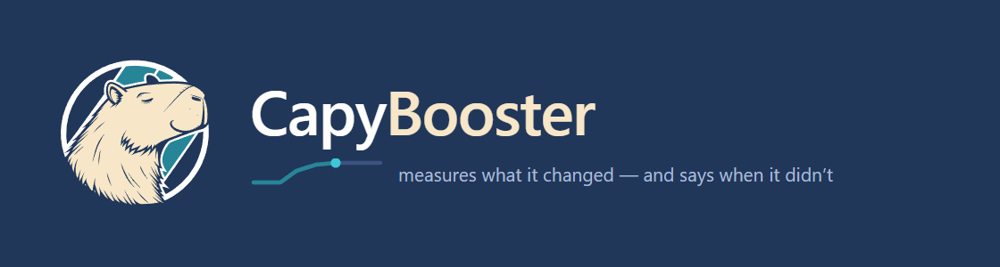

<p align="center">
  
</p>

<p align="center">
  <a href="https://github.com/kur7ma/CapyBooster/releases/latest"></a>
  <a href="https://github.com/kur7ma/CapyBooster/releases"></a>
  <a href="LICENSE"></a>
  
</p>

<p align="center">
  <a href="README.md">English</a> ·
  <b>Русский</b> ·
  <a href="FAQ.ru.md">FAQ</a> ·
  <a href="ИЗМЕНЕНИЯ.md">Что менялось</a> ·
  <a href="SECURITY.md">Безопасность</a>
</p>

<p align="center">
  <a href="https://github.com/kur7ma/CapyBooster/releases/latest/download/CapyBooster-latest.zip"></a>
</p>

CapyBooster настраивает Windows под соревновательные игры, по шагу за раз. После
каждой группы правок он меряет, насколько быстро система отзывается, и печатает
вердикт, в том числе «разницы, которую можно измерить, нет». Это обычный
PowerShell, а всё, что он сделал, откатывается одним щелчком.

## Скачать и запустить

1. Скачайте [CapyBooster-latest.zip](https://github.com/kur7ma/CapyBooster/releases/latest/download/CapyBooster-latest.zip).
2. По желанию, это минута: [проверьте, что файл наш](#проверка-архива).
3. Распакуйте архив **целиком** в любую папку. Изнутри zip он не запустится.
4. Запустите **START.cmd** и согласитесь на запрос прав администратора.

Мастер спросит язык, проверит систему, создаст точку восстановления и проведёт
по шагам в шести группах: подготовка, ОС, процессор, видеокарта, игра, итог. На
каждом шаге решаете вы: Enter выполняет шаг, `s` пропускает, `p` показывает, что
он изменит, `a` доделывает остальное без вопросов. Шаг, которому нужна
перезагрузка, спросит разрешения даже в режиме без вопросов, а после входа в
систему мастер продолжит с того же места.

## Что вы получаете

* **26 модулей, 142 карточки твиков.** В карточке написано, что твик трогает,
  насколько это подтверждено (`измерено`, `ожидаемо`, `спорно`), какого
  эффекта ждать и чем вы за него платите. Цену мастер печатает до вопроса.
* **Замер после каждой группы**, три прогона на точку. Среди вердиктов отчёта:
  * опоздания уменьшились или выросли;
  * неразличимо: изменение меньше разброса между прогонами;
  * сравнивать нельзя: между двумя замерами в BIOS переключали SMT или один из
    них сняли от батареи.

  Если машина такая тихая, что измеритель ничего не различает, пак пропускает
  синтетические замеры и объясняет почему.
* **Ваши игры по имени.** Профили Counter-Strike 2, Valorant, Apex Legends и
  Delta Force. Пак находит установленную игру и даёт приоритет её настоящему
  exe-файлу.
* **NVIDIA и AMD Radeon**: профили драйвера для обеих, а на ноутбуке раздел
  мощности между процессором и видеокартой.
* **Три эксперимента** меряют, помогает ли на вашей машине популярный твик:
  TimerTool, отключение MPO, отключение сжатия памяти.
* **Проверка своей работы.** `verify.ps1` читает живую систему и замечает
  настройку, которую сбросило обновление драйвера или вы поменяли руками.
* **HTML-отчёт** с командой отката рядом с каждым модулем.

## Популярные твики получают отказ с причиной

В отчёте 22 популярных твика, которые пак не трогает, и у каждого своя причина.
Восемь из них:

| Отказ | Почему |
|---|---|
| Отключить UAC | На Windows 11 ломает приложения из Store, Параметры, Терминал и поиск в «Пуске» |
| Глобальный таймер 1 мс | С Windows 10 2004 разрешение таймера своё у каждого процесса |
| ISLC и резидентные чистильщики памяти | Список ожидания это кэш файлов, а не мусор |
| Удалить службы | Вернуть их можно только починкой Windows; пак меняет только тип запуска |
| Заглушить Windows Update | Вместе с ним Defender перестаёт получать новые базы |
| Nagle и твики TCP | Игровой трафик идёт по UDP, там алгоритм Нейгла не работает |
| Удалить встроенные приложения | Приложение, которое вы не открываете, процессор не занимает |
| Отключить счётчики производительности | Перестают работать Afterburner, HWiNFO и системный монитор |

## Проверка архива

Архив можно проверить до запуска:

1. **Контрольная сумма.** У каждого релиза есть файл `SHA256SUMS`, а GitHub
   показывает SHA-256 рядом с каждым файлом. В PowerShell, в папке с архивом:

   ```powershell
   Get-FileHash .\CapyBooster-latest.zip -Algorithm SHA256
   ```

   Результат должен совпасть с первой строкой `SHA256SUMS`, до последнего
   символа. В Git Bash или на Linux: `sha256sum -c --ignore-missing SHA256SUMS`.
2. **VirusTotal.** В заметках каждого релиза есть ссылка на проверку именно его
   архива. Для 5.6.5 ни один из 65 антивирусов ничего не нашёл:
   [отчёт проверки](https://www.virustotal.com/gui/file/4560ed11b192e5c9a6de30d498cfe0b5b003cd64c06144c7a9d24bac3bc0c38f).

В архиве 5.6.6 лежат 189 файлов, и все они текстовые: скрипты PowerShell,
настройки в JSON, профили NVIDIA и документация. Ни одного .exe или .dll. Два
маленьких помощника, запуск игры и замер таймера, лежат в том же архиве
исходниками на C#, и пак собирает их на вашем ПК, когда они нужны шагу.

Цифровой подписи у архива нет, поэтому Windows может написать, что издатель
неизвестен. Подтверждает файл контрольная сумма.

## Что остаётся на ПК

* Ни службы, ни драйвера, ни программы в трее. Когда мастер закончил, от него
  ничего не работает.
* Задачи планировщика подписаны CapyBooster. Разовая задача продолжает мастер
  после перезагрузки. Если вы взяли шаг про память, появится задача без
  расписания: она срабатывает, только когда вы запускаете её перед игрой,
  одной командой или своим ярлыком. Модуль прерываний умеет завести задачу,
  которая заново раскладывает прерывания при входе, но только если вы попросите
  об этом сами.
* Сеть: проверка обновлений спрашивает у этого репозитория последнюю версию;
  `START.cmd -NoUpdateCheck` оставляет мастер без сети. Шаг «Инструменты»
  спрашивает разрешения и качает PresentMon (Intel), GoInterruptPolicy и, на
  видеокартах NVIDIA, NVIDIA Profile Inspector с их официальных страниц на
  GitHub. Версия каждого закреплена, SHA-256 сверяется.
* Телеметрии нет. Архив диагностики лежит у вас, пока вы сами его не отправите;
  имя учётной записи, имя ПК, номера аккаунтов Steam и домен организации в нём
  скрыты.

## Откат

* Точка восстановления системы до прогона.
* Каждый модуль сохраняет старые значения до записи, в папку пака и в общее
  хранилище на машине, так что удалённая папка не отнимает дорогу назад.
* `UNDO.cmd` возвращает систему туда, где она была до первого запуска пака.
  `START.cmd undo -Preview` печатает план и ничего не меняет.

## Что нужно

* Windows 11 24H2 (сборка 26100) или новее: под неё пак настроен.
* Windows 10 работает. Мастер предупредит в начале и пропустит настройки, которые
  есть только в Windows 11. Версии 5.6.1 и 5.6.4 чинили то, что нашлось на
  Windows 10.
* Права администратора.
* Windows PowerShell 5.1, тот, что уже есть в Windows. Ставить нечего.

## Античиты

Secure Boot и TPM пак не трогает нигде, а именно их требуют FACEIT AC и Easy
Anti-Cheat. Исключение одно, Valorant: Vanguard нужна целостность памяти, поэтому,
если Valorant установлен, мастер предупредит до шага, который её выключает.
Играете в Valorant, пропустите этот шаг.

## Обновление и язык

Мастер при старте проверяет новую версию, показывает, что изменилось, и обновляет
папку на месте. Замеры, резервные копии и прогресс остаются.

Русский и английский. Мастер берёт язык вашей Windows и запоминает выбор;
`START.cmd -Lang ru` переключит его потом.

## Вопросы, замеры, баги

* [FAQ](FAQ.ru.md): как идёт прогон, «неразличимо», откат одного модуля.
* [Обсуждения → Results](https://github.com/kur7ma/CapyBooster/discussions/categories/results):
  несите замеры. Большая часть [журнала изменений](ИЗМЕНЕНИЯ.md) выросла из
  отчётов с чужих машин.
* [Issues](https://github.com/kur7ma/CapyBooster/issues): если стало хуже.
  `START.cmd` соберёт архив диагностики, его можно приложить.
* [SECURITY.md](SECURITY.md): как сообщить о проблеме безопасности не публично.

Лицензия MIT.
